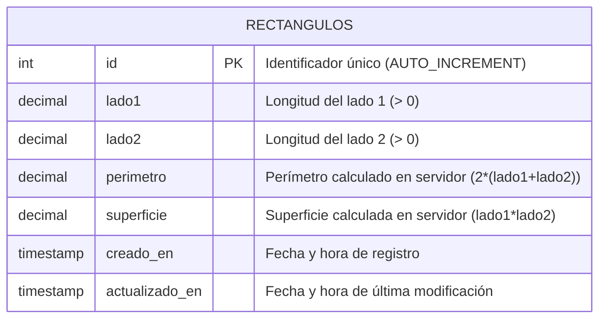

# Ejercicio 1: Administración y Cálculo de Rectángulos

API REST desarrollada con **Node.js**, **ExpressJS** y **MySQL** para la gestión y cálculo geométrico de rectángulos, con validaciones estrictas mediante **express-validator**.

---

## 1. Fundamentación del Diseño

### Modelo de Datos (MySQL)
La información se persiste en la base de datos `db_rectangulos`, dentro de la tabla `rectangulos`:

| Columna | Tipo de dato | Restricciones | Descripción |
|---|---|---|---|
| `id` | `INT` | `PRIMARY KEY AUTO_INCREMENT` | Identificador único del rectángulo |
| `lado1` | `DECIMAL(10, 2)` | `NOT NULL` | Medida del primer lado (> 0) |
| `lado2` | `DECIMAL(10, 2)` | `NOT NULL` | Medida del segundo lado (> 0) |
| `perimetro` | `DECIMAL(10, 2)` | `NOT NULL` | Perímetro calculado por el servidor |
| `superficie` | `DECIMAL(10, 2)` | `NOT NULL` | Superficie calculada por el servidor |
| `creado_en` | `TIMESTAMP` | `DEFAULT CURRENT_TIMESTAMP` | Fecha de creación del registro |
| `actualizado_en` | `TIMESTAMP` | `DEFAULT CURRENT_TIMESTAMP ON UPDATE CURRENT_TIMESTAMP` | Fecha de última modificación |

**Decisiones sobre el modelo:**
1. **Precisión numérica**: Se utiliza el tipo `DECIMAL(10, 2)` para evitar los clásicos errores de redondeo de punto flotante (`FLOAT`/`DOUBLE`), permitiendo almacenar medidas con decimales precisos.
2. **Persistencia de valores calculados**: Aunque el perímetro y la superficie son valores derivados, el enunciado solicita explícitamente persistirlos en la base de datos para agilizar consultas directas y reportes sin requerir recálculos en la capa de datos.

---

## 2. Diagrama Entidad-Relación



> También se encuentra disponible en formato gráfico como `diagrama_er.png`.

---

## 3. Lógica de Negocio y Seguridad de Datos

- **Cálculo exclusivo en el servidor**: Al crear (`POST`) o modificar (`PUT`), la API acepta **únicamente** `lado1` y `lado2`.
  - $\text{Perímetro} = 2 \times (\text{lado1} + \text{lado2})$
  - $\text{Superficie} = \text{lado1} \times \text{lado2}$
- **Bloqueo de campos derivados**: Se valida explícitamente con `express-validator` que el cliente **no** envíe los campos `perimetro` o `superficie` en el cuerpo de la petición. Si se envían, la API rechaza la solicitud con un código `400 Bad Request`, garantizando la integridad de los datos.

---

## 4. Endpoints de la API

| Método | Endpoint | Descripción | Códigos HTTP |
|---|---|---|---|
| `GET` | `/` | Información general de la API | `200` |
| `GET` | `/rectangulos` | Lista todos los rectángulos ordenados por ID | `200`, `500` |
| `GET` | `/rectangulos/:id` | Obtiene el detalle de un rectángulo por ID | `200`, `400`, `404`, `500` |
| `POST` | `/rectangulos` | Registra y calcula un nuevo rectángulo | `201`, `400`, `500` |
| `PUT` | `/rectangulos/:id` | Modifica los lados y recalcula valores | `200`, `400`, `404`, `500` |
| `DELETE` | `/rectangulos/:id` | Elimina un rectángulo existente | `200`, `400`, `404`, `500` |

---

## 5. Validaciones con express-validator

- **Lados (`lado1` y `lado2`)**:
  - Deben existir en el cuerpo de la solicitud (`exists()`).
  - No pueden estar vacíos (`notEmpty()`).
  - Deben ser numéricos estrictamente mayores a cero (`isFloat({ gt: 0 })`).
- **Campos protegidos (`perimetro`, `superficie`)**:
  - Se verifica que no vengan en el payload (`not().exists()`).
- **Parámetro `id` de ruta**:
  - Debe ser un entero positivo (`isInt({ min: 1 })`).
- **Respuestas de error uniformes**:
  - Cuando alguna validación falla, se responde con código HTTP `400` y una estructura JSON clara con el detalle de cada campo inválido.

---

## 6. Instrucciones de Instalación y Ejecución

1. **Instalar dependencias**:
   ```bash
   npm install
   ```

2. **Crear base de datos en MySQL**:
   Ejecutar el script `schema.sql` en MySQL Workbench, phpMyAdmin o terminal:
   ```bash
   mysql -u root -p < schema.sql
   ```

3. **Configurar variables de entorno**:
   Copiar `.env.example` a `.env` y ajustar credenciales si es necesario:
   ```bash
   cp .env.example .env
   ```

4. **Iniciar el servidor**:
   ```bash
   npm start
   ```
   O en modo desarrollo:
   ```bash
   npm run dev
   ```

5. **Pruebas**:
   Abrir el archivo `rectangulos.http` con la extensión REST Client de VS Code para ejecutar las pruebas automáticas.
