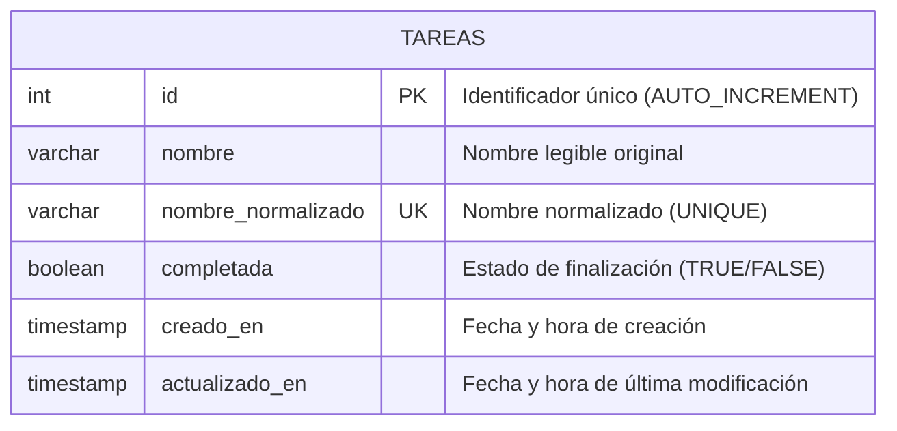

# Ejercicio 2: Gestión de Tareas con Unicidad y Filtro por Estado

API REST desarrollada con **Node.js**, **ExpressJS** y **MySQL** para la administración de tareas, implementando un criterio consistente de unicidad de nombres, filtros por estado y validaciones exhaustivas con **express-validator**.

---

## 1. Fundamentación del Diseño

### Modelo de Datos (MySQL)
La información se persiste en la base de datos `db_tareas`, en la tabla `tareas`:

| Columna | Tipo de dato | Restricciones | Descripción |
|---|---|---|---|
| `id` | `INT` | `PRIMARY KEY AUTO_INCREMENT` | Identificador único de la tarea |
| `nombre` | `VARCHAR(255)` | `NOT NULL` | Nombre con formato original del usuario |
| `nombre_normalizado` | `VARCHAR(255)` | `NOT NULL UNIQUE` | Nombre estandarizado para garantizar unicidad |
| `completada` | `BOOLEAN` | `NOT NULL DEFAULT FALSE` | Indica si la tarea está completada o pendiente |
| `creado_en` | `TIMESTAMP` | `DEFAULT CURRENT_TIMESTAMP` | Fecha de creación del registro |
| `actualizado_en` | `TIMESTAMP` | `DEFAULT CURRENT_TIMESTAMP ON UPDATE CURRENT_TIMESTAMP` | Fecha de última modificación |

**Decisiones de diseño:**
1. **Doble almacenamiento de nombre**: Se almacena el `nombre` original tal como lo ingresó el usuario (respetando mayúsculas y estilo visual), junto con `nombre_normalizado` que permite hacer búsquedas y verificar unicidad de forma ultra veloz y sin ambigüedades.
2. **Índice UNIQUE en base de datos**: Además de validar a nivel aplicación, la tabla posee una restricción `UNIQUE` sobre `nombre_normalizado`, garantizando integridad de datos ante posibles condiciones de carrera (race conditions).

---

## 2. Criterio de Comparación Consistente para Unicidad

Para determinar cuándo dos nombres de tareas se consideran iguales, se implementa una función de normalización que aplica las siguientes reglas de manera determinista:

1. **Recorte de extremos (`trim`)**: Elimina cualquier espacio en blanco al inicio o al final.
2. **Colapso de espacios múltiples intermedios**: Reemplaza secuencias de dos o más espacios internos por un único espacio (`replace(/\s+/g, ' ')`).
3. **Conversión a minúsculas (`toLowerCase`)**: Asegura una comparación indiferente de mayúsculas/minúsculas.

### Ejemplo de equivalencia:
Las siguientes entradas se consideran exactamente la misma tarea y son rechazadas por la API con código `409 Conflict`:
- `"Estudiar para el parcial"`
- `"  ESTUDIAR   PARA EL   PARCIAL  "`
- `"estudiar para el parcial"`

---

## 3. Diagrama Entidad-Relación



> También se encuentra disponible en formato gráfico como `diagrama_er.png`.

---

## 4. Endpoints de la API

| Método | Endpoint | Parámetros / Body | Descripción | Códigos HTTP |
|---|---|---|---|---|
| `GET` | `/` | Ninguno | Información general de la API | `200` |
| `GET` | `/tareas` | Query: `?estado=completadas\|pendientes\|todas` o `?completada=true\|false` | Listado general o filtrado por estado | `200`, `400`, `500` |
| `GET` | `/tareas/:id` | Param: `id` | Detalle de una tarea por su ID | `200`, `400`, `404`, `500` |
| `POST` | `/tareas` | Body: `{ "nombre": "...", "completada": false }` | Crea una nueva tarea (verifica unicidad) | `201`, `400`, `409`, `500` |
| `PUT` | `/tareas/:id` | Body: `{ "nombre": "...", "completada": true }` | Modificación completa de la tarea | `200`, `400`, `404`, `409`, `500` |
| `PATCH` | `/tareas/:id` | Body: `{ "completada": true }` | Actualización rápida de estado | `200`, `400`, `404`, `500` |
| `DELETE` | `/tareas/:id` | Param: `id` | Elimina una tarea por su ID | `200`, `400`, `404`, `500` |

---

## 5. Validaciones con express-validator

- **Parámetro de consulta `estado`**:
  - Si se proporciona, debe pertenecer al conjunto admitido: `completadas`, `pendientes` o `todas`. Cualquier otro valor es rechazado con `400 Bad Request`.
- **Parámetro de consulta `completada`**:
  - Si se proporciona, debe ser un valor booleano válido (`true` o `false`).
- **Campo `nombre`**:
  - Obligatorio, tipo cadena de texto (`isString()`), no vacío tras aplicar `trim()`, con longitud válida entre 3 y 255 caracteres.
- **Campo `completada`**:
  - Debe ser estrictamente booleano (`isBoolean()`).
- **Parámetro `id` de ruta**:
  - Entero positivo mayor o igual a 1 (`isInt({ min: 1 })`).

---

## 6. Instrucciones de Instalación y Ejecución

1. **Instalar dependencias**:
   ```bash
   npm install
   ```

2. **Crear base de datos en MySQL**:
   ```bash
   mysql -u root -p < schema.sql
   ```

3. **Configurar variables de entorno**:
   Copiar `.env.example` a `.env` y ajustar si es necesario:
   ```bash
   cp .env.example .env
   ```

4. **Iniciar el servidor**:
   ```bash
   npm start
   ```

5. **Pruebas**:
   Abrir el archivo `tareas.http` con la extensión REST Client de VS Code para probar las peticiones.
