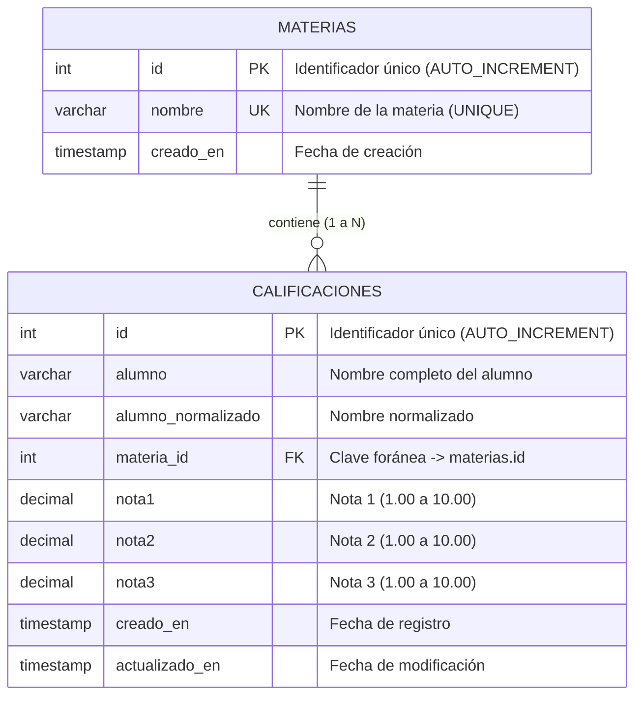

# Ejercicio 3: Gestión de Calificaciones y Materias con Modelo Relacional

API REST desarrollada con **Node.js**, **ExpressJS** y **MySQL** para la administración de materias universitarias y calificaciones de alumnos, implementando un modelo relacional con claves foráneas, reglas de unicidad compuesta alumno–materia y validaciones completas con **express-validator**.

---

## 1. Fundamentación del Diseño y Modelo Relacional

### Tabla Independiente: `materias`
Almacena el catálogo de materias disponibles en la carrera:

| Columna | Tipo de dato | Restricciones | Descripción |
|---|---|---|---|
| `id` | `INT` | `PRIMARY KEY AUTO_INCREMENT` | Identificador único de la materia |
| `nombre` | `VARCHAR(100)` | `NOT NULL UNIQUE` | Nombre oficial de la materia |
| `creado_en` | `TIMESTAMP` | `DEFAULT CURRENT_TIMESTAMP` | Fecha de creación del registro |

### Tabla Relacionada: `calificaciones`
Almacena el registro de cursada y las 3 calificaciones de cada alumno en una materia:

| Columna | Tipo de dato | Restricciones | Descripción |
|---|---|---|---|
| `id` | `INT` | `PRIMARY KEY AUTO_INCREMENT` | Identificador único del registro |
| `alumno` | `VARCHAR(100)` | `NOT NULL` | Nombre legible del alumno |
| `alumno_normalizado` | `VARCHAR(100)` | `NOT NULL` | Nombre estandarizado para comparaciones |
| `materia_id` | `INT` | `NOT NULL` | Clave foránea referenciando a `materias(id)` |
| `nota1` | `DECIMAL(4, 2)` | `NOT NULL` | Primera nota (escala 1.00 a 10.00) |
| `nota2` | `DECIMAL(4, 2)` | `NOT NULL` | Segunda nota (escala 1.00 a 10.00) |
| `nota3` | `DECIMAL(4, 2)` | `NOT NULL` | Tercera nota (escala 1.00 a 10.00) |
| `creado_en` | `TIMESTAMP` | `DEFAULT CURRENT_TIMESTAMP` | Fecha de creación del registro |
| `actualizado_en` | `TIMESTAMP` | `DEFAULT CURRENT_TIMESTAMP ON UPDATE CURRENT_TIMESTAMP` | Fecha de última modificación |

### Clave Foránea e Integridad Referencial
- Se define la restricción `CONSTRAINT fk_calificaciones_materia FOREIGN KEY (materia_id) REFERENCES materias(id) ON DELETE RESTRICT ON UPDATE CASCADE`.
- `ON DELETE RESTRICT` impide que una materia sea eliminada accidentalmente si ya posee calificaciones registradas.

### Regla de Unicidad Alumno–Materia
- El enunciado exige impedir más de un registro para la misma combinación de alumno y materia, tanto al crear como al modificar.
- Se implementa a nivel base de datos mediante la restricción única compuesta:
  ```sql
  CONSTRAINT uq_alumno_materia UNIQUE (alumno_normalizado, materia_id)
  ```
- A nivel servidor, se normaliza el nombre del alumno (recorte de extremos, minúsculas, espacios unificados) antes de consultar o persistir, y se verifica de forma explícita antes de cualquier inserción o actualización, devolviendo un código `409 Conflict` descriptivo si se detecta colisión.

---

## 2. Escala de Calificaciones y Datos Derivados

### Escala de Notas Documentada
- **Escala**: Se adopta la escala académica estándar universitaria argentina, donde las calificaciones son numéricas en el rango de **1.00 a 10.00** (permitiendo valores con hasta dos decimales).
- **Exactamente tres notas**: La API exige la presencia estricta de las tres notas (`nota1`, `nota2`, `nota3` o arreglo `notas: [n1, n2, n3]`).

### Datos Derivados Calculados en el Servidor
Para cada registro se calculan dinámicamente y se adjuntan en la respuesta de la API:
- **Promedio**: $\text{promedio} = \frac{\text{nota1} + \text{nota2} + \text{nota3}}{3}$ (redondeado a 2 decimales).
- **Condición Académica**:
  - `promocionado`: Si el promedio es $\ge 8.00$.
  - `aprobado`: Si el promedio está entre $6.00$ y $7.99$.
  - `reprobado`: Si el promedio es $< 6.00$.

---

## 3. Diagrama Entidad-Relación



> También se encuentra disponible en formato gráfico como `diagrama_er.png`.

---

## 4. Endpoints de la API

### Materias
| Método | Endpoint | Descripción | Códigos HTTP |
|---|---|---|---|
| `GET` | `/materias` | Lista todas las materias registradas | `200`, `500` |
| `POST` | `/materias` | Registra una nueva materia (`nombre`) | `201`, `400`, `409`, `500` |

### Calificaciones
| Método | Endpoint | Descripción | Códigos HTTP |
|---|---|---|---|
| `GET` | `/calificaciones` | Lista todas las calificaciones con datos de materias (JOIN). Soporta filtros `?materia_id=...` y `?alumno=...` | `200`, `400`, `500` |
| `GET` | `/calificaciones/:id` | Detalle de una calificación específica por ID | `200`, `400`, `404`, `500` |
| `POST` | `/calificaciones` | Registra calificaciones de un alumno en una materia | `201`, `400`, `404`, `409`, `500` |
| `PUT` | `/calificaciones/:id` | Modifica notas o datos de una calificación | `200`, `400`, `404`, `409`, `500` |
| `DELETE` | `/calificaciones/:id` | Elimina una calificación por ID | `200`, `400`, `404`, `500` |

---

## 5. Validaciones con express-validator

- **`alumno`**: Obligatorio, cadena de texto, no vacío, longitud entre 3 y 100 caracteres.
- **`materia_id`**: Obligatorio, entero positivo mayor a 0, existencia verificada en la base de datos.
- **`nota1`, `nota2`, `nota3`**:
  - Cada nota es obligatoria.
  - Cada nota debe ser numérica con `isFloat({ min: 1.0, max: 10.0 })`.
  - Se admite tanto formato plano (`nota1`, `nota2`, `nota3`) como arreglo `notas: [n1, n2, n3]` de exactamente 3 elementos.
- **Unicidad alumno-materia**: Verificada previo a la inserción/actualización. Si ya existe, responde con `409 Conflict`.
- **Parámetro `id`**: Entero positivo (`isInt({ min: 1 })`).

---

## 6. Instrucciones de Instalación y Ejecución

1. **Instalar dependencias**:
   ```bash
   npm install
   ```

2. **Crear base de datos y tablas en MySQL**:
   ```bash
   mysql -u root -p < schema.sql
   ```

3. **Configurar variables de entorno**:
   Copiar `.env.example` a `.env`:
   ```bash
   cp .env.example .env
   ```

4. **Iniciar el servidor**:
   ```bash
   npm start
   ```

5. **Pruebas**:
   Abrir el archivo `calificaciones.http` con la extensión REST Client de VS Code para ejecutar la batería de pruebas completa.
