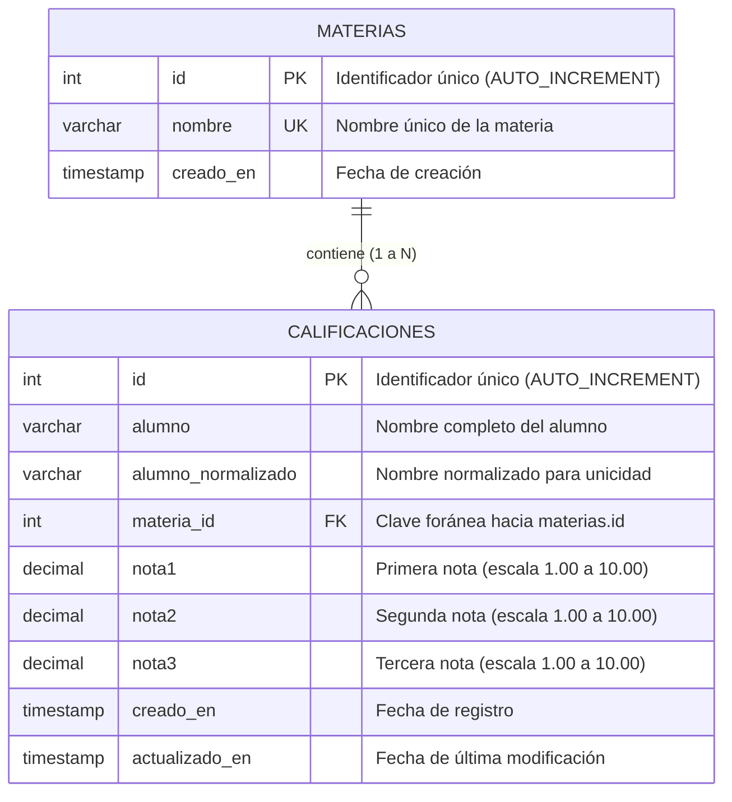

# Diagrama Entidad-Relación - Ejercicio 3: Calificaciones

El siguiente diagrama representa el modelo relacional implementado en MySQL para la gestión de alumnos, materias y calificaciones con clave foránea y regla de unicidad:

> **Regla de integridad y unicidad**:
> - Clave foránea: `calificaciones.materia_id` referencia a `materias.id` (`ON DELETE RESTRICT ON UPDATE CASCADE`).
> - Restricción de unicidad: `UNIQUE KEY (alumno_normalizado, materia_id)` para asegurar que ningún alumno posea registros repetidos en la misma materia.
>
> También se encuentra disponible en formato gráfico como `diagrama_er.png`.
